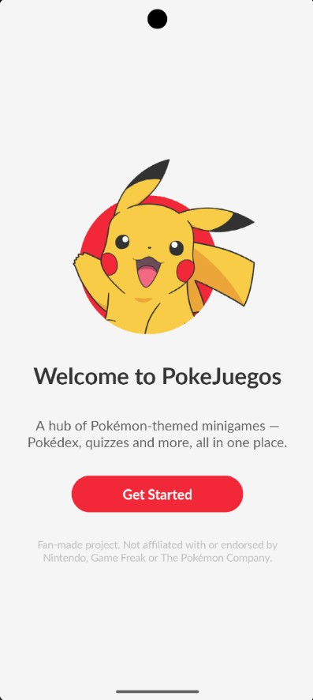
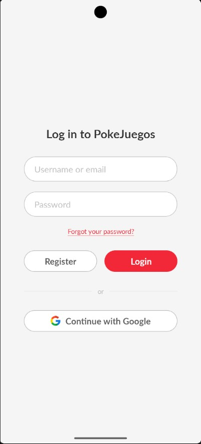
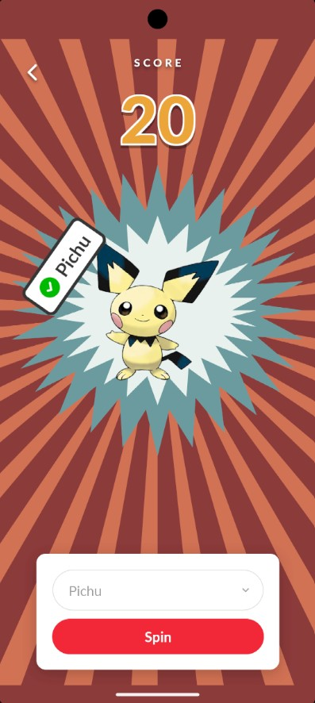
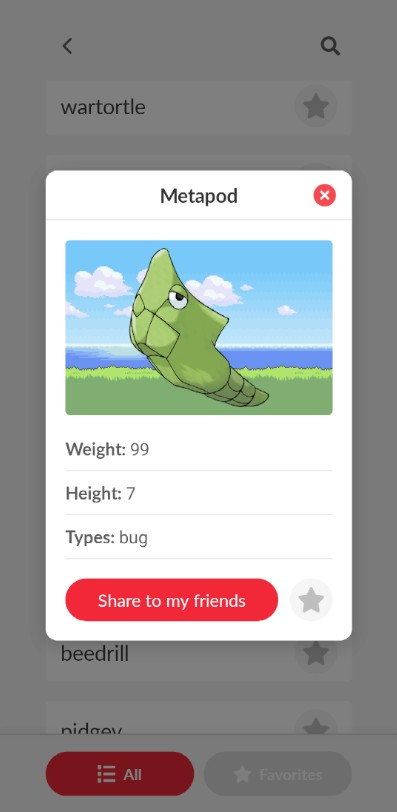

# PokeJuegos

A small Pokémon game hub built end to end in .NET 10: a **.NET MAUI** app for Android and Windows, a **REST API** with
real authentication (email/password and Google OAuth2), and a tiny **Razor Pages** site that handles the links sent by
email (account activation and password reset).

The app includes a **Pokédex** (generations I–III, search and favorites) and **"Who's That Pokémon?"**, a roulette
game where you guess the Pokémon from its silhouette before the fuse burns out.

Read the full architecture in **[Architecture](docs/ARCHITECTURE.md)**.

<p align="center">
  
  
  
  
  
  
  <br>
  
  
  
  
  
</p>

## Screenshots

<p align="center">
  
  
  
  
</p>

---

## Running it locally

> **Quick start with Docker:** create a `.env` with `JWT_SECRET=<32+ characters>` and run `docker compose up --build`.
> That starts PostgreSQL (created and seeded), the API on `:5224` and the web on `:3000`; then run the app as in
> [step 5](#5-run-the-app). Details: [Run with Docker](docs/DOCKER.md). The steps below set everything up without Docker.

### 1. Prerequisites

- [.NET 10 SDK](https://dotnet.microsoft.com/download/dotnet/10.0)
- [PostgreSQL](https://www.postgresql.org/download/) 14 or newer
- For the app: the .NET MAUI workload. The easiest way is **Visual Studio 2026** with the *.NET Multi-platform App UI
  development* workload, which also installs the Android SDK and emulator. From the command line:
  `dotnet workload install maui`
- Optional:
  - A Gmail account with an [App Password](https://myaccount.google.com/apppasswords) (or any SMTP server), to send
    the activation and password-reset emails
  - A Google Cloud OAuth client, for "Sign in with Google" (see [Configure the API](docs/CONFIGURE_API.md#google-sign-in-optional))

### 2. Create the database

```bash
psql -U postgres -c "CREATE DATABASE pokejuegos;"
psql -U postgres -d pokejuegos -f db/script.sql
psql -U postgres -d pokejuegos -f db/seed.sql   # put your SMTP account in seed.sql first
```

Details, what the seed creates and the default admin account: [Create the database](docs/CREATE_DATABASE.md).

### 3. Configure the API

`PokeJuegos.Api/appsettings.json` has placeholders in uppercase. Put the real values (connection string, JWT
secret and, optionally, Google credentials) in a git-ignored `appsettings.Development.json` or in environment
variables. Step by step, including Google sign-in: [Configure the API](docs/CONFIGURE_API.md).

### 4. Run the API and the web

```bash
dotnet run --project PokeJuegos.Api --launch-profile http   # http://localhost:5224 — Swagger at /swagger
dotnet run --project PokeJuegos.Web                         # http://localhost:3000
```

### 5. Run the app

```bash
dotnet build PokeJuegos.Mobile -t:Run -f net10.0-windows10.0.19041.0   # Windows
dotnet build PokeJuegos.Mobile -t:Run -f net10.0-android               # Android emulator
```

Running it from Visual Studio, how the Android emulator reaches the API, and the shared launch profiles that start
API + web + app at once: [Run the app](docs/RUN_THE_APP.md).

### 6. Try the full flow

1. Register in the app. You get an activation email.
2. The link opens `http://localhost:3000/activate?...` (PokeJuegos.Web), which activates the account through the API.
3. Log in with the same credentials, or use **Sign in with Google**. A first-time Google user is asked to choose a
   username.
4. **Forgot password?** sends a link to `/reset-password`. For a Google account without a password, the link lets you
   create one.

Step by step, with every request and rule behind it: [Authentication flow](docs/FLOW_AUTH_REGISTER.md).

The Pokédex and the roulette game work offline. Their data (386 Pokémon, sprites included) ships with the app.

### (Optional) Release APK

```bash
dotnet publish PokeJuegos.Mobile -f net10.0-android -c Release
```

The APK is signed with a local keystore if `%USERPROFILE%\.pokejuegos\pokejuegos-dev.keystore` exists (alias
`pokejuegos`, store and key passwords in `keystore-pass.txt` and `key-pass.txt` in the same folder). Otherwise, the
.NET for Android debug key is used. To create the keystore:

```bash
keytool -genkeypair -v -keystore %USERPROFILE%\.pokejuegos\pokejuegos-dev.keystore -alias pokejuegos -keyalg RSA -keysize 2048 -validity 10000
```

---

## Documentation

| Document | Contents |
|---|---|
| [Architecture](docs/ARCHITECTURE.md) | Solution overview, tech stack, backend layers, mobile app structure |
| [Run the app](docs/RUN_THE_APP.md) | Windows, Android emulator, Visual Studio launch profiles |
| [Create the database](docs/CREATE_DATABASE.md) | Scripts, seed data, default admin account |
| [Configure the API](docs/CONFIGURE_API.md) | Secrets, environment variables, Google sign-in setup |
| [API reference](docs/API_REFERENCE.md) | Endpoints, authentication, error responses |
| [Authentication flow](docs/FLOW_AUTH_REGISTER.md) | Step-by-step registration, activation, login, Google OAuth2, password recovery |
| [Database design](db/DESIGN.md) | Table design decisions: games, scores, user preferences, sync |

## Design decisions

- **Result pattern over exceptions.** Services return `Result<T>` for expected business failures. Exceptions are
  only for unexpected errors and are handled by `ExceptionHandlingMiddleware`.
- **Server-side JWT sessions.** Every issued token has a hashed record in `user_sessions`, so sessions can be revoked
  before they expire. Logging in revokes the user's previous sessions.
- **No account hijacking through Google.** If an email already belongs to a password account, Google sign-in with
  that email is rejected.
- **Offline game data.** The Pokémon list and details are generated from PokeAPI once and bundled with the app (list
  and detail kept separate, like PokeAPI's own endpoints), so the games need no network.
- **Trimming-safe Release builds.** Trimming and AOT warnings, plus XAML bindings that can't be compiled, are build
  errors (`WarningsAsErrors` in the `.csproj`). Code that relies on reflection fails the build instead of crashing
  only in the Release APK.
- **Enum storage.** C# enums are PascalCase (`Member`, `Active`). EF Core stores them as uppercase strings (`MEMBER`,
  `ACTIVE`).

## Disclaimer

Pokémon and Pokémon character names are trademarks of Nintendo, Creatures Inc. and GAME FREAK inc. This is a
non-commercial portfolio project, not affiliated with or endorsed by them. Pokémon data comes from
[PokeAPI](https://pokeapi.co/).
